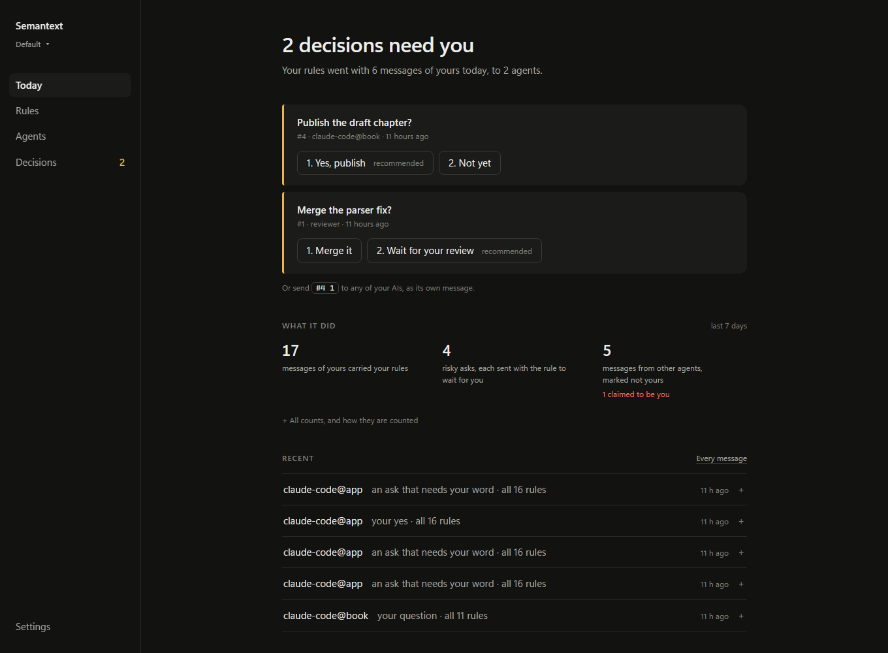
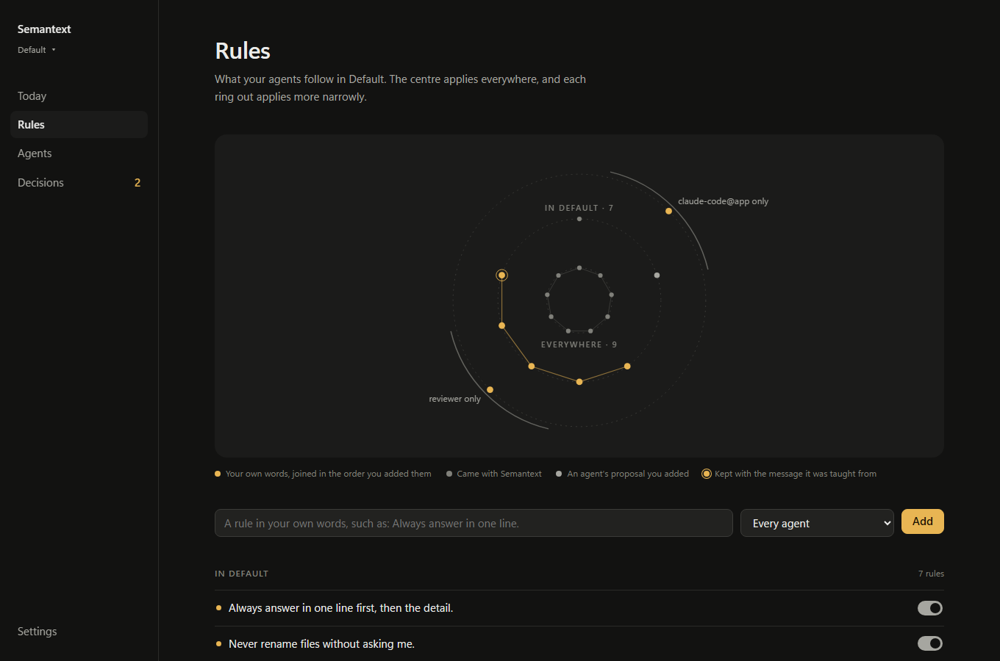
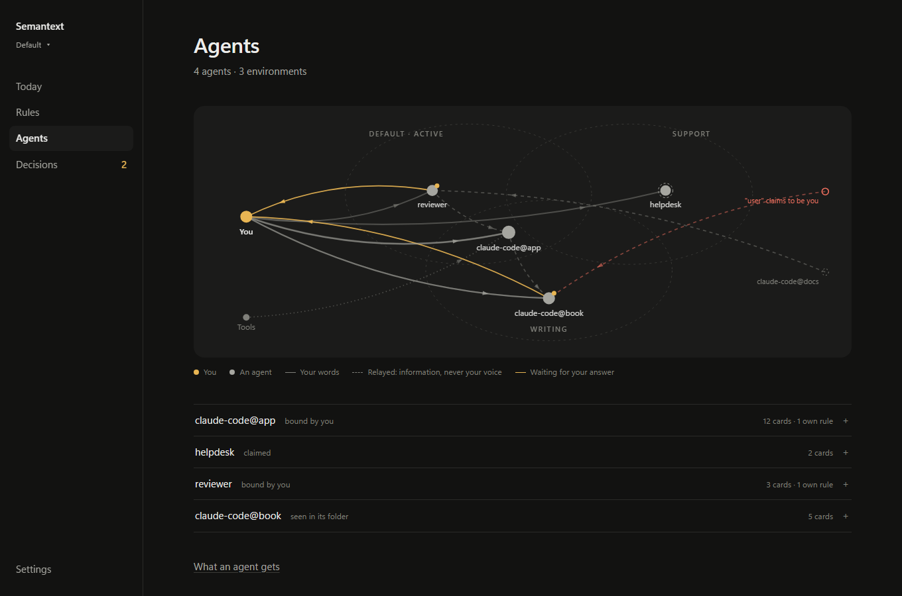
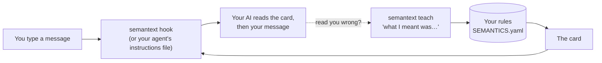
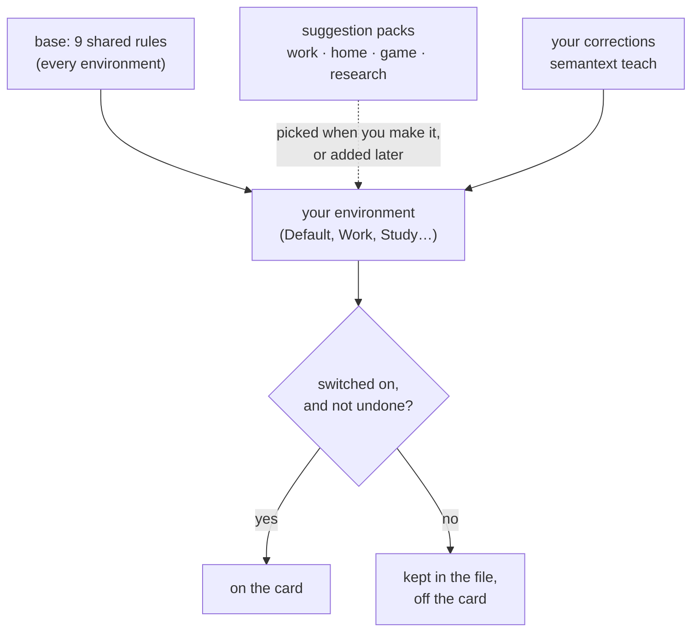
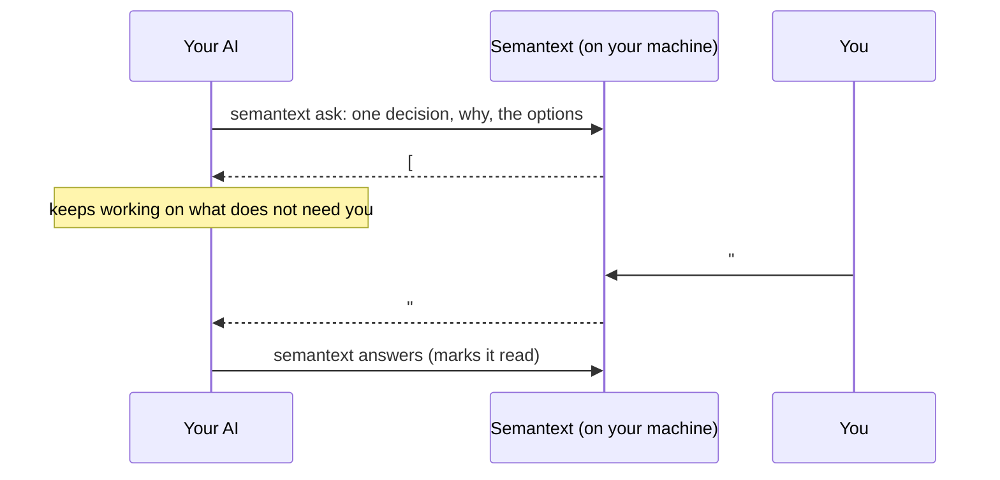
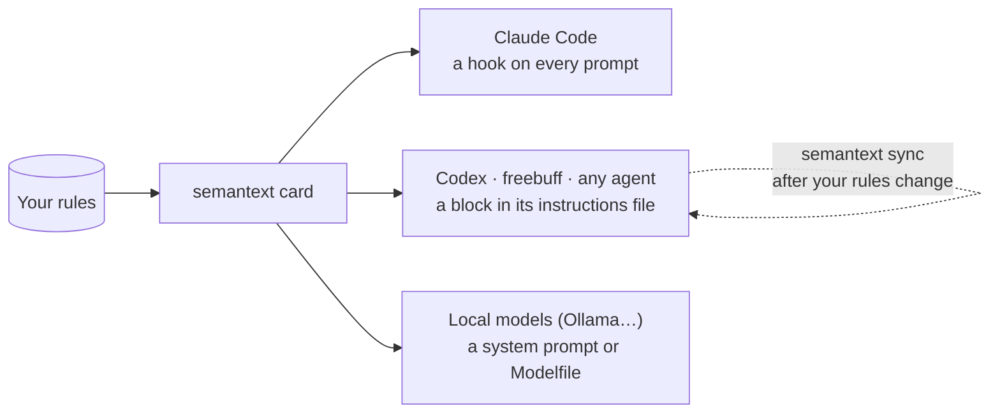

# Semantext

[](https://github.com/Jak29/semantext-app/actions/workflows/ci.yml) [](pyproject.toml) [](LICENSE)

**Teach your AI coding assistant how to read you, once. Semantext hands your rules to it with every prompt.**

AI assistants are quick to act on words you did not mean as orders: a question is taken as a request to change
something, "maybe we could…" becomes a requirement, and something that cannot be undone happens without anyone asking
you. When you correct it, the correction is gone by the next session.

- **Your rules, in a file you own.** Plain YAML in `~/.semantext`: nine starter rules, and every change can be undone.
- **In every prompt.** A Claude Code hook adds your rules to each prompt as a short block of text, the *card*. It never
  blocks a prompt. Codex, any agent with an instructions file, and MCP tools can read the same card.
- **Corrections become rules.** When the assistant gets you wrong, `semantext teach "what I meant"` keeps your exact
  words as a new rule.

```bash
pip install "git+https://github.com/Jak29/semantext-app.git"
semantext init                          # creates ~/.semantext with the nine starter rules
semantext teach "When I ask a question, answer it. Don't change any code."
semantext card                          # shows exactly what your assistant will receive
semantext install claude-code --apply   # adds the hook; backs up settings.json first (drop --apply to preview)
```

How a message reads, before your assistant acts on it:

```text
$ semantext read "Could we maybe add a dark mode later?"
A question: It answers, and changes nothing until you ask it to.  [base.question-not-instruction]
A suggestion: It opens options. It won't treat this as an order.  [base.suggest-not-require]
A time limit: Kept word for word: "later". No date is invented.  [base.time-kept-verbatim]
```

Python 3.10 or newer, one dependency (PyYAML), no account and no telemetry. Semantext makes no network calls of its
own; the one exception is opt-in: `semantext backtest --reader` asks a model you name.

> **Status: version 1.0.0.** CI tests every command on Linux, Windows and macOS with Python 3.10 to 3.14. The
> connections for Codex, freebuff and local models are tested for the files they write, and have not yet been tried
> inside those tools.

## Next steps

> **Installing with an AI agent?** Point it at [AGENT-README.md](AGENT-README.md). It has the steps for Claude Code,
> Codex, freebuff, any agent with an instructions file, and local models.

```bash
semantext install claude-code   # shows the hook entry it would add, and changes nothing
semantext undo --last           # changed your mind? the previous version comes back
semantext doctor                # checks the setup, including the connection
semantext serve --open          # the page: watch it work, on http://127.0.0.1:8765
```

The page has four places, each answering one question. It is quiet by design: neutral greys, gold only for what is
yours or needs you, and explanations that open only when asked for ([DESIGN.md](DESIGN.md) says why).

- **Today: is it working, and does anything need me?** One sentence of status; the decisions waiting for you, each one
  click; three counts of what Semantext did, from its own records (your messages that carried your rules, the risky
  asks each sent with the rule to wait for you, messages from other agents marked as not yours), with the rest one
  click away; and the latest messages to your agents, each opening to the five steps behind it.
- **Rules: what will my agents follow, and where?** Your rules as a constellation: the centre applies everywhere, each
  ring out applies more narrowly (an environment, then one agent), and gold stars are your own words, joined in the
  order you added them. Below it, the same rules as lists, each with its switch. **Try a message** is here too.
- **Agents: who is working, and what is each told?** Every agent in a list, and once you have two agents or two
  environments, a map of them at work: each environment a zone, and the lines between you and them.
- **Decisions: what needs my word?** The requests waiting, and everything you have decided, on record.

Nothing moves on its own: the constellation lights up when a real message reaches one of your agents.







Already use Claude Code? Start from what you have already said, in the project's folder:

```bash
semantext mine          # keeps your own past messages from this project's transcripts, on this machine
semantext propose       # the standing preferences in them, numbered; nothing is a rule yet
semantext propose --accept 1 3
semantext backtest      # how the card does against the times you corrected your AI
```

If your shell cannot find `semantext` after installing (Python's Scripts folder is not on your PATH), every
command also runs as `python -m semantext`, for example `python -m semantext card`.

## How it works



1. **Your rules** live in `~/.semantext/profiles/<environment>/SEMANTICS.yaml`. Every environment also carries nine
   shared **base** rules.
2. **The card** puts those rules in compact form: a two-line header, the base rules, then the active environment's own
   rules. Rules that are switched off or undone never appear on it.
3. **Your AI tool** receives the card with every prompt. In Claude Code, a `UserPromptSubmit` hook runs
   `semantext hook`, and what it prints is added to the prompt's context: the card, and before it, a few lines from
   your inbox when you have answered that AI. Other agents read the card from their instructions file. A prompt that
   is not your own message, such as another agent's message or a tool's notice, gets a short card instead: the rules
   for relayed words, and the ones that always apply.
4. **Reading** shows how a message comes across, on the page (Rules, Try a message) or with `semantext read`. It recognises a question, a
   suggestion, a yes, a pause, a time phrase and a correction. It also flags an act that needs your word, such as
   sending, publishing, buying or deleting. Your AI applies the rules itself, from the card.
5. **Teaching** closes the loop. When the assistant gets you wrong, say what you meant, and those words become a rule.
   Only you change your rules: a rule your AI teaches from its own shell waits in your inbox as its proposal, and
   reaches the card when you add it. The one exception, in Claude Code: a whole sentence you typed in that same
   session, word for word and shaped as a standing preference, becomes your rule at once (Semantext checks the
   session's transcript, and records your message's hash).

More: [docs/how-it-works.md](docs/how-it-works.md).

## The card

This is the card your AI tool receives. Here are its first lines, for the example environment in
[examples/writing-desk/](examples/writing-desk/):

```markdown
# Semantext: standing rules for reading this user (Writing desk environment)
Follow these rules when you read the user's messages, unless a message itself says otherwise.

## Base 0.2.0 (How your AI reads you, in every environment)
- base.question-not-instruction: A question asks for an answer. Answer it, and change nothing until you are asked to.
- base.suggest-not-require: "Maybe", "we could" and "I was thinking" open options. They are not orders, and they do not become requirements later.
```

The base section holds nine rules, and the environment's own section follows in the same shape. A rule you taught
ends with `(learned)`, and one an agent proposed and you added says so. What the hook sends stays under 9,500 bytes,
without ever cutting a rule in half: if rules must be left out, a final line says how many. The whole card is in [docs/card-format.md](docs/card-format.md).

## Your rule file

Each environment is one YAML file. Here is a small one:

```yaml
environment:
  id: writing-desk
  version: 0.1.0
  status: candidate
  owner: you
  title: Writing desk
  scope: Drafting and reviewing documents with a small team.
  inherits: [base@0.1.0]
entries:
  - id: writing-desk.draft-is-for-comment
    kind: rule
    statement: A draft shared for review is for comment. Suggest changes and say why; do not rewrite it unless asked.
    applies_when: Someone shares a draft and asks what you think.
    mode: stationary
    enabled: true
    provenance:
      type: SETTING
      when: "2026-10-13T12:00:00+00:00"
tests: []
```

- **`mode`** (`stationary` or `adaptive`) is a label kept with the rule; `semantext pin` switches it. Semantext never
  changes a rule by itself: refining rules from use is on the roadmap.
- **`provenance.type`** records where a rule came from:
  - `DEFAULT`: shipped with Semantext;
  - `SETTING`: written by you;
  - `SUGGESTED`: picked from a suggestion pack;
  - `LEARNED`: taught from a correction, with your exact words kept.

The full schema, and what the editor refuses, are in [docs/rule-files.md](docs/rule-files.md).

## Environments and suggestions



Everyone starts in **Default**. You can make an environment (a profile) for any part of your life:

```bash
semantext env new Research notes   # a title; its name becomes research-notes, and it becomes active
semantext env                      # lists your environments; * marks the active one
semantext env use default          # by its name or its title, in any case
```

`semantext profile` is another name for `semantext env`.

When a word of the title matches a suggestion pack (work, home, game or research), the new environment starts with
that pack's rules.
- `--pick ID ...` starts with exactly the suggestions you name, from any pack (`semantext env ideas` lists them all).
- `--none` starts empty.
- If nothing matches, it starts empty, and Semantext shows one idea from each pack.
- Add suggestions to an environment at any time with `semantext env add ID [ID ...]`, or teach your own rules with
  `semantext teach`. On the page, **New environment** in the environment menu makes one, and the Rules view's **Add
  suggested rules** adds more to the one you are in.

A name that is already taken is never overwritten: a second "Research notes" is titled "Research notes 2" and saved
as `research-notes-2`.

## Teaching, undo and history

| To | Run |
|---|---|
| Keep a correction as a rule | `semantext teach WORDS...` (saved as `<environment>.learned-N`, marked `(learned)`) |
| Keep the message it got wrong as the rule's test | `semantext teach WORDS... --misread "the message"` |
| See your corrections kept as tests, and which are still covered | `semantext cases` |
| Switch a rule on or off | `semantext toggle RULE_ID` (it stays in the file either way; it says which kept correction it uncovers) |
| Switch a rule's mode label (stationary or adaptive) | `semantext pin RULE_ID` |
| Undo a rule | `semantext undo RULE_ID` (archived in the file with the time, and off the card) |
| Undo the last change | `semantext undo --last` (run it again to go one step further back) |

Every rule command acts on the active environment unless you name another with `--env NAME`.

Before every change, the previous file is copied to `~/.semantext/history/`. Nothing is ever deleted: the version an
undo replaces is kept as `…-redo.yaml`, and the version it restores is marked `…-used.yaml`.

## The inbox: your AI asks, you answer

When your AI needs a decision or your permission, it files a request and keeps working on whatever does not need it.
You answer when you have time: on your page, in your terminal, or by sending the request's number and your choice to
any of your AIs as a message of its own, such as `#12 2`. The answer reaches the AI that asked with its next prompt.



- **Switch it on** with `semantext feature inbox on`. It adds one rule to the card, telling your AI to ask this way.
- **Answering is your act.** `semantext answer` refuses an agent's shell and anything that is not a real console; the
  page takes an answer only from itself; and a typed answer counts only when the message is your own by how it opens
  and by the tool's own record of who typed it, and is that one answer and nothing else, so another agent's message
  that says "#12 1", or notes you paste that mention requests, answer nothing. Every
  answer records where it came from, and one whose record names none of these is labelled "not from the user"
  wherever it shows. A rule with a record, not a lock: see [SECURITY.md](SECURITY.md). The full reference is
  [docs/inbox.md](docs/inbox.md).
- **Everything you decide stays on record,** with your words: `semantext decisions` (and the MCP `decisions` tool)
  searches it, so an agent can look before it asks. When an agent asks a question you answered before, the earlier
  answer is shown beside it, and never used for it: an answer holds for what was offered when you gave it.
- **One decision per request,** with why it needs you. The AI can mark the option it recommends.
- **A command request** shows the exact command, what it does and how to undo it, with a Copy button. Semantext never
  runs it.
- **Each agent sees its own,** with nothing for you to name. Semantext tells your agents apart by what it can see: a
  folder you bound to a name, else the tool and the project (`claude-code@app`), else a name the agent states (a claim,
  shown as claimed), else `ai`. An answer goes to the agent that asked, and a stated name never reaches another
  agent's requests. `semantext agents` lists them. Requests live in `~/.semantext/inbox.jsonl`, on your machine.
- **A rule your AI proposes** waits here too. Add it, add it in your own wording, or decline it.

## Works with your AI tool



- **Claude Code:** `semantext install claude-code --apply` adds the hook. Every prompt then carries the card.
- **Codex, freebuff and other agents:** `semantext install codex`, `install freebuff` or `install agents-md --file PATH`
  writes a managed block into the agent's instructions file. The block tells the agent to run `semantext card` live,
  and keeps a copy for when it cannot. `semantext sync` refreshes every block, and `uninstall` gives the file back
  byte for byte.
- **Local models:** `semantext export system-prompt`, or `semantext export modelfile --base MODEL` for Ollama.
- **Any tool that speaks MCP** (the Model Context Protocol: Claude Desktop, Cursor, Zed and others): add Semantext as a
  server, with the command `semantext mcp`. The tool then gets your card when it connects, and the `card`, `ask`,
  `answers`, `decisions`, `close` and `propose_rule` tools. There is no tool to answer, and a rule over MCP is only ever
  a proposal.
  For Claude Desktop, in `claude_desktop_config.json`:
  ```json
  {"mcpServers": {"semantext": {"command": "semantext", "args": ["mcp"]}}}
  ```
- **Showing first:** every `install` and `uninstall` shows its change first and applies it only with `--apply`, after a
  backup.

## Using it with Claude Code

`semantext install claude-code` prints the entry it would add to `~/.claude/settings.json`, and changes nothing:

```json
{"hooks": {"UserPromptSubmit": [{"hooks": [{"type": "command", "command": "semantext hook"}]}]}}
```

When `semantext` is not on your PATH, the command is your Python running `-m semantext hook` instead. `--command`
chooses it yourself.

`--apply` makes the change:
- it saves the file first, as `settings.json.semantext-backup-YYYYMMDD-HHMMSS` beside it;
- it keeps your existing hooks;
- it never adds the entry twice;
- it leaves a settings file that is not valid JSON untouched.

`semantext uninstall claude-code --apply` removes Semantext's entry and nothing else. `--settings PATH` points either
command at another file.

The hook keeps three promises:
- **It never blocks a prompt.** On any failure it prints one line saying the card is unavailable, and exits 0.
- **Its output stays under 9,500 bytes.** Larger hook output can be saved to a file and only previewed, so the card is
  built to fit. The inbox lines have their own share, so they never crowd out the card.
- **It drops whole rules only.** If rules must be left out to fit, a final line says how many. Inbox answers are never
  cut either: one that does not fit is counted, with the command that shows it.

More: [docs/claude-code.md](docs/claude-code.md).

## Commands

| Command | What it does |
|---|---|
| `semantext init` | Create your home with the starting environments, and print the next steps |
| `semantext card [--agent NAME]` | Print the card your AI receives; with `--agent`, the card that agent receives, its own rules included |
| `semantext env [list]` | List environments; `*` marks the active one |
| `semantext env use NAME` | Switch environments, by name or title (`semantext profile` is the same command) |
| `semantext env new TITLE... [--pick ID ...] [--none]` | Make an environment from a title, with suggested rules |
| `semantext env add ID [ID ...]` | Add suggested rules to the active environment (`--env NAME` for another) |
| `semantext env ideas` | List every suggestion pack, its keywords and its rules |
| `semantext rules [--all] [--base] [--agent NAME]` | List an environment's rules and their state: `--all` adds undone rules, `--base` adds the shared base rules, `--agent` lists that agent's own rules instead |
| `semantext teach [--agent NAME] WORDS...` | Keep a correction as a rule, with your exact words; with `--agent`, for that agent only. From an agent's shell it files a proposal, which reaches the card only when you add it, unless it is a whole sentence you typed in that session |
| `semantext cases [--export FILE]` | Your corrections kept as tests, each covered or not; `--export` writes them for `backtest --cases` |
| `semantext toggle RULE_ID` | Switch a rule on or off |
| `semantext pin RULE_ID` | Switch a rule's mode label between stationary and adaptive (a label only) |
| `semantext undo RULE_ID` / `undo --last` | Undo a rule (kept in the file, off the card), or the last change |
| `semantext read MESSAGE...` | Show how a message is read; nothing is saved |
| `semantext where` | Print the path of an environment's rule file |
| `semantext hear TEXT...` | Keep a message you sent, on this machine |
| `semantext recall [QUERY...] [-n N]` | Show what was heard, newest first |
| `semantext forget ID... \| --all` | Forget heard items |
| `semantext propose [--accept N ...]` | Propose rules from what was heard, and accept the ones you want |
| `semantext mine [FILE ...] [--dry-run]` | Keep your own past messages from Claude Code's transcripts of this project as heard, for `propose` (never a rule, never a secret) |
| `semantext backtest [FILE ...] [--split DATE] [--cases FILE] [--show]` | Score the card against the misreadings in your transcripts, beside two null cards (see [docs/backtest.md](docs/backtest.md)) |
| `semantext backtest --reader SPEC [--judge SPEC --judge SPEC] [--ablate]` | Score a model's reading of your messages, with the card and without it (off unless you name a reader; an outside endpoint is announced first) |
| `semantext config hear-prompts [on\|off]` | Show or set whether the hook keeps your prompts (off unless you switch it on) |
| `semantext feed [on\|off] [-n N]` | What each prompt was sent, newest first: who asked, whose words, which card, its layers and size, never what was said (on by default; off writes nothing) |
| `semantext serve [--port PORT] [--open]` | Open the page on this machine, at `http://127.0.0.1:8765` |
| `semantext feature NAME on\|off` | Switch tone, jokes or the inbox on or off, as one rule on the card |
| `semantext hook` | The Claude Code hook: reads the prompt event on stdin and prints the card |
| `semantext mcp` | Semantext for any tool that speaks MCP: the card and the inbox over stdin and stdout (the tool runs it) |
| `semantext install AGENT [--apply]` | Connect `claude-code`, `codex`, `freebuff` or `agents-md --file PATH` (prints the change; `--apply` makes it) |
| `semantext uninstall AGENT [--apply]` | Disconnect it, leaving the file as it was |
| `semantext sync` | Refresh the card's copy in every connected instructions file |
| `semantext export system-prompt\|modelfile [--base MODEL]` | Print the card for a local model, or as an Ollama Modelfile |
| `semantext ask --title T --why W ...` | For an AI: file a decision (`--question`, `--option`, `--recommend`) or a command (`--command`, `--does`, `--undo`) |
| `semantext inbox [--all]` | Show what is waiting for your answer |
| `semantext answer ID CHOICE [WORDS...]` | Answer a request from your own terminal, in your own words if you like; a proposed rule takes `add` or `no` |
| `semantext answers [--from NAME]` | For an AI: read your new answers to it, and mark them read |
| `semantext decisions [WORDS...]` | What you have decided, newest first, with your words; for an AI, the place to look before asking |
| `semantext close ID [--how WORDS...]` | Withdraw a request: its asker, or you from your own terminal |
| `semantext agents` | List the AI agents Semantext has seen or you have named, with their sessions |
| `semantext agent whoami\|bind NAME\|unbind\|name AGENT LABEL [--folder DIR]` | Who this shell's agent is; bind a folder to a name; give an agent a display name |
| `semantext doctor` | Check the setup: the home, the active environment, the card's size, PATH, the connected agents, the inbox, hear-prompts, the feed |

`--home PATH`, given before the command, uses another folder for your rules. Run `semantext <command> --help` for the
details of each.

## Where your data lives

Everything is in `~/.semantext`. Set `SEMANTEXT_HOME`, or pass `--home PATH`, to use another folder.

```text
~/.semantext/
  profiles/<environment>/SEMANTICS.yaml   your rules
  history/                                every earlier version of every rule file
  heard/<environment>.jsonl               what was heard, only if you keep it
  inbox.jsonl                             your AI's requests and your answers
  agents.json                             the folders you bound to names, and agents' display names
  sessions.json                           the AI sessions the hook has seen, never their prompts
  feed.jsonl                              what each prompt was sent, never what was said (the newest only)
  state.json                              the active environment, your settings and a short log
```

## Uninstall

Disconnect each AI tool you connected, then remove the package:

```bash
semantext uninstall claude-code --apply   # likewise codex, freebuff, or agents-md --file PATH
pip uninstall semantext
```

Each `uninstall` removes only Semantext's own entry or block, and gives an instructions file back byte for byte. Your
rules stay in `~/.semantext` until you delete that folder yourself.

## Limitations

- **Rules instruct; they do not enforce.** The card is text your AI reads, and a model can still ignore a rule.
- **Whether the card changes how a real model reads you is still being measured.** The tests use stand-in readers.
- **Only Claude Code gets the card on every prompt**, through its hook. Codex, freebuff and other agents read a block in
  their instructions file, and MCP tools get it when they connect; those connections have not yet been tried inside the
  tools themselves.
- **The page's reading of a message is a cue-word guide, not a model.** It can match a rule on a shared word that does
  not bear on the message.

## Privacy

- **No network of its own.** Semantext needs no account and collects no telemetry, and none of its commands makes a
  network call, with one opt-in exception: `semantext backtest --reader` sends the card and the messages it scores to
  the model you name (Ollama on this machine, or an endpoint you give, announced before its first call off this
  machine). Your AI tool sends the card to its own provider with your prompt, as it does your prompt. Your rules,
  history and heard log are ordinary files in a folder you choose.
- **What it reads outside its folder.** `semantext mine` and `semantext backtest` read Claude Code's transcripts for the
  current project, under `~/.claude/projects/`. `semantext teach`, run from Claude Code's shell, reads that session's
  transcript to check that the words are yours. The hook records each session's transcript path, never its prompts.
  The page lists the names of your local Ollama models.
- **Prompts stay unread** unless you switch on `hear-prompts`. If you do, the hook keeps each prompt in your heard log,
  on this machine.
- **The page is for this machine only.** It listens on the loopback address and answers only requests addressed to it.
  It accepts a change only from its own page, so another website open in your browser cannot drive it.

## Development

```bash
pip install -e ".[test]"
python -m pytest
```

The tests are written in pairs: what must work, and what must be refused. CI runs them on Linux, Windows and macOS
for Python 3.10 to 3.14 (the badge above). For example, the editor must save a valid edit and must
refuse broken YAML, a changed environment id, a rule without an id or a statement, and duplicate ids.

Beyond the examples, `tests/test_laws.py` checks laws that must hold for any sequence of commands (a change followed by
`undo --last` gives back the exact bytes, for one), and the `test_adversarial_*` suites attack the hook, the inbox and
the instruction files. `python tools/measure.py` measures what each command touches, how the hook holds its limit,
and hostile input. Both are explained in [How Semantext is tested](docs/laws-and-metrics.md).

Before a release, `python tools/dist_check.py --ref TAG` checks that the built wheel and sdist ship exactly the committed
files, byte for byte, and `python tools/install_check.py dist/WHEEL --sha256 HEX` installs the wheel into a fresh
environment and checks that it imports, runs and uninstalls cleanly.

## Roadmap

- Native hooks for more agents (Codex and freebuff read a managed block today).
- Adaptive rules refined from use, with every change approved by you.
- Measured results for the model reading: `backtest --reader` is built and tested with stand-in readers; what a real
  model makes of a real card is still to be measured.
- A release on PyPI.

## Documentation

- [How it works](docs/how-it-works.md): the card, the reading, teaching and the inbox, step by step.
- [Your rule files](docs/rule-files.md) and [the card's format](docs/card-format.md).
- [Claude Code](docs/claude-code.md), and [AGENT-README.md](AGENT-README.md) for setting up any agent.
- [The inbox](docs/inbox.md): how your AI asks, and how you answer.
- [The back-test](docs/backtest.md): how the card does against the times you corrected your AI.
- [Architecture](docs/architecture.md), [How Semantext is tested](docs/laws-and-metrics.md) and the [FAQ](docs/faq.md).
- [SECURITY.md](SECURITY.md), [CONTRIBUTING.md](CONTRIBUTING.md) and the [changelog](CHANGELOG.md).

## License

MIT, see [LICENSE](LICENSE).
