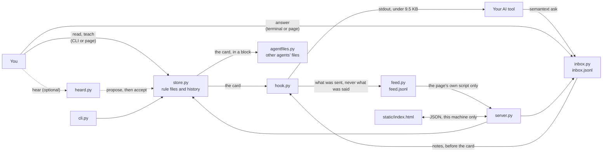

# Architecture

Semantext is one Python package, with no dependency beyond PyYAML.
- **Everything you own** lives in plain files under one folder: rule files, their history, a log of what was heard, and
  a small state file.
- **The package ships only** the starting rules, the suggestion packs and the page.

## The flow



1. **Your words go into the store.** `semantext read`, or Test on the page, shows how a message is read.
   `semantext teach`, or Rules on the page, keeps a correction as a rule. Every change goes through `store.py`, which copies the previous version into
   `history/` before writing. Changing your rules is your act: from an agent's shell, `teach` files a proposal in the
   inbox instead, and every other change is refused.
2. **The store renders the card:** a two-line header, the shared base rules, then the active environment's rules that
   are switched on and not undone.
3. **The hook passes it to the AI.** Claude Code runs `semantext hook` with every prompt. The hook prints your inbox's
   notes, then the card, fitted under 9,500 bytes without cutting a rule or an answer, and Claude Code adds it to the
   prompt's context. Other agents get the card through a block in their instructions file, written by `agentfiles.py`.
4. **The inbox carries questions back.** An agent files a request with `semantext ask`. You answer it in your terminal,
   on the page, or by sending `#12 2` to any of your AIs as a message of its own, which the hook records when that one
   answer is the whole message and the message is your own by how it
   opens and by the tool's record; `inbox.py` appends every event to `inbox.jsonl`. The hook's notes carry your answer
   to the agent that asked, and what you decided stays on record for agents to search (`semantext decisions`).
5. **The feed shows the work.** For each card it hands out, the hook appends one line to `feed.jsonl`: who asked,
   whose words, the card's form, its rules by layer, its size, the inbox answers that went with it, and for your own
   words what kind of message the quick reading took it for, never what was said. The page reads it through its
   server, counts what it did from it and the inbox (`server.metrics`), and runs the same steps (`hook.compose`) dry
   for Try a message.

## The modules

| Module | What it does |
|---|---|
| `paths.py` | Where things live: your home (`~/.semantext`, or `SEMANTEXT_HOME`), the package's data and the page. It creates the home on first use by copying in the starting environments, and never overwrites. |
| `store.py` | The rule files: load and save, environments and suggestions, toggle, pin, teach, undo and undo-last, the editor's checks, the card, and the cue-word reading of a message. |
| `heard.py` | The local log of what was heard (`heard/<environment>.jsonl`): hear, recall and forget, and proposals made from sentences shaped like rules. |
| `inbox.py` | The inbox: requests (decisions, commands and rule proposals), answers, withdrawals and reads, appended to `inbox.jsonl` under a file lock; the checks on who may answer and whose request is whose; the strict form of an answer typed in chat; the register (`search`, and the same question answered before, shown and never used); and the notes the hook puts before the card, within 3,000 bytes. |
| `agents.py` | Who is asking, with nothing named: a folder you bound, a name the agent states (a claim), the tool and the project, or `ai`, each with how it was known and a key the inbox matches on. The bindings and names (`agents.json`) and the sessions the hook saw (`sessions.json`), written under a lock. |
| `sender.py` | Whose words a prompt carries: yours, another agent's, or a tool's notice, from how the prompt opens, then from the tool's own record, and which of them told (`whose`). |
| `hook.py` | The Claude Code entry point. It reads the prompt event on stdin, works out the agent, keeps the prompt if `hear-prompts` is on and the prompt is yours, records the answers you typed in your own message (only with the tool's record), and prints what it recorded, that agent's inbox notes and the card (the short relay card for words that are not yours) under the size limit (`compose`), then adds a line to the feed. It never blocks a prompt. |
| `feed.py` | The feed (`feed.jsonl`): one line per card handed out, in exactly its declared fields, with any value shaped like a key withheld; cut back to its newest half past 512 kB; skipped when busy, and silent when switched off. |
| `mcp.py` | `semantext mcp`: the card and the inbox for any tool that speaks the Model Context Protocol, as JSON-RPC over stdin and stdout. The card in its instructions; the `card`, `ask`, `answers`, `decisions`, `close` and `propose_rule` tools; no answer tool, and rules only as proposals. A client's own name is a claim. |
| `claude.py` | The installer for `~/.claude/settings.json`: the entry, the backup, the merge, and the removal of Semantext's entry and nothing else. |
| `agentfiles.py` | The installer for other agents' instruction files (Codex, freebuff, any file you name): one block between two markers, a backup first, byte-for-byte uninstall, and `sync`. |
| `server.py` | The page's server: a small JSON API over the store, the inbox and the feed, behind the address, `Host`, header and origin checks described in [SECURITY.md](../SECURITY.md); the counts of what Semantext did (`metrics`, from its own records only); the register's search; and the dry `explain` behind Try a message. |
| `cli.py` | The `semantext` command and its subcommands, over the same store. |
| `static/index.html` | The page, in one file: Today, Rules (with Try a message), Agents (with What an agent gets), Decisions and Settings, each at its own address. |
| `data/` | The starting environments (`profiles/base`, `profiles/default`) and the suggestion packs (`suggestions/*.yaml`). |

## Files on disk

```text
~/.semantext/
  profiles/<environment>/SEMANTICS.yaml   your rules, one file per environment
  history/                                every earlier version, plus the -redo and -used markers of undo
  heard/<environment>.jsonl               what was heard, only if you keep it
  inbox.jsonl                             your inbox: every request, answer, withdrawal and read, append-only
  inbox.lock, inbox.seq                   the inbox's lock, and the last number it gave out
  agents.json                             the folders you bound to agents' names, display names, and project names
  sessions.json, agents.lock              the AI sessions the hook saw (never their prompts; the newest 200), and their lock
  feed.jsonl, feed.lock                   what each prompt was sent, never what was said (the newest only), and its lock
  state.json                              the active environment, your settings, the files Semantext installed into,
                                          and a short log
```

## Design choices

- **Plain files, not a database,** so you can read, diff, back up and share your rules.
- **Undo copies, and never deletes.** Undoing a rule archives it in its file. Undoing the last change restores the
  previous version.
- **Whole rules or none.** A rule cut in half can lose the very limit it states, so the card never cuts one.
- **The hook never blocks.** A broken setup must not stop your work, so the hook's worst case is a one-line note.
- **An agent asks, and you answer.** The inbox file is append-only, so every request, answer and withdrawal stays on
  record. The checks on who may answer stop accidents, and each answer's record says where it came from.
- **This machine only.** Semantext makes no network calls of its own (the one opt-in exception is
  `backtest --reader`, which calls the model you name), and the page answers only on loopback.

## Where to start reading

- `store.py`: `card()`, `learn()`, `undo()` and `undo_last()`.
- `hook.py`: `fit()`, the size rule.
- `inbox.py`: `ask()`, `answer()` and `card_notes()`.
- `server.py`: `_host_ok()`, `_origin_ok()` and `make_server()`, the guards, and the answer's own `Origin` rule.
